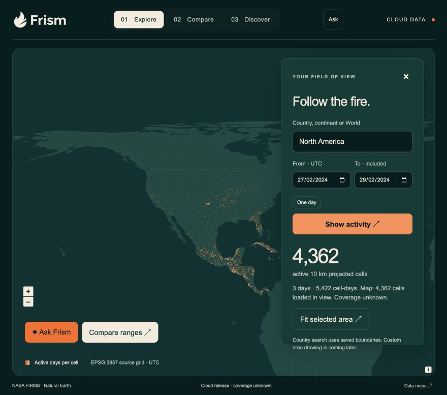
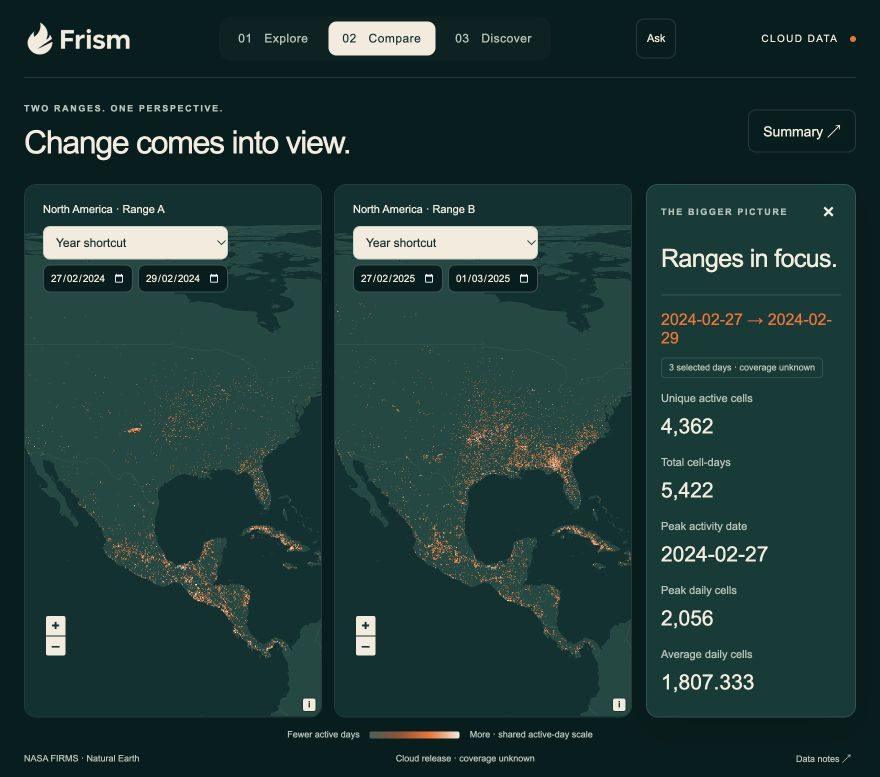
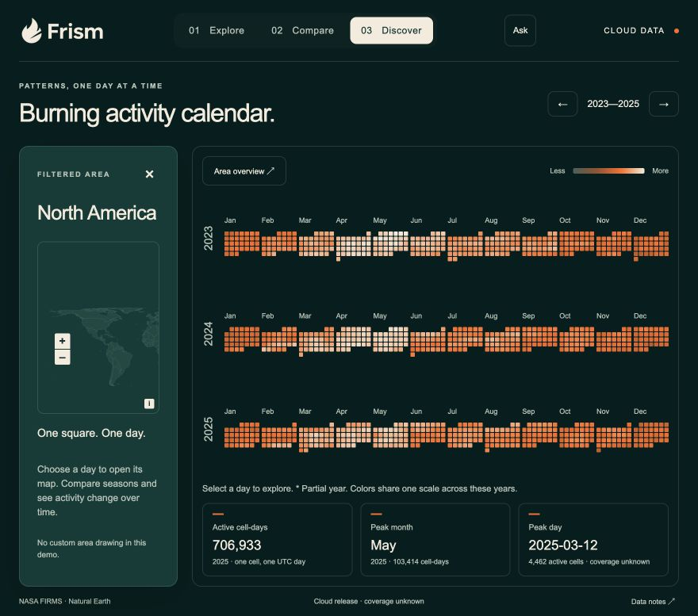

# Frism

**Explore satellite fire activity across places and time.** Frism is an interactive map and learning tool for students and researchers. It shows active grid cells, compares date ranges, and turns daily counts into a calendar.

**Live website:** [apex4space.vercel.app](https://apex4space.vercel.app)

## See it in action

| Explore hotspots | Compare date ranges |
| --- | --- |
|  |  |

| Discover daily patterns | Ask about the data |
| --- | --- |
|  |  |

These screenshots were taken from the live site on 15 November 2026.

## What you can do

- Search for a country, continent, or the world; choose one day or a date range; zoom in to see active cells.
- Compare two date ranges, including ranges that overlap, with linked maps and a shared color scale.
- Browse a three-year daily activity calendar and open any day on the map.
- Ask simple questions about the selected data. The cloud site gives short database summaries. A local installation can also use Ollama with `gemma4:e2b`.
- Open and close panels to give the map more space. The main views fit without page scrolling.

## Data and meaning

The current release covers **2000-11-01 to 2026-11-11**. Its 313 monthly Parquet files contain country, grid cell, and UTC day memberships. The site offers 230 source countries, seven geographic groups, and World. The source files are stored in Vercel Blob, **not in this Git repository**; this repository keeps code, checked metadata, small calendar summaries, and documentation.

A cell is 10,000 metres wide in the source **EPSG:3857** grid. The map transforms its shape to **EPSG:6933** for display. These cells are not equal-area ground measurements. An *active cell* is a distinct grid cell observed in the selected period; a *cell-day* counts one active cell on one UTC day. Neither measure is a fire count or burned area. Observation coverage is unknown, so an empty day does not prove there was no fire. Country membership follows the source data, and overlapping country cells are counted once in group totals.

See the [data validation notes](documents/logs/2026-11-15/detail/detail-parquet-release.md) for the release checks and source limits.

## How it works

```text
Browser (OpenLayers 10) → FastAPI → checked monthly Parquet files
        maps + calendar        area/date queries   DuckDB aggregation
```

The frontend uses plain HTML, CSS, and JavaScript with OpenLayers WebGL rendering. The Python API uses FastAPI and DuckDB. The cloud version reads one monthly file at a time from Vercel Blob and checks its hash before use. The local version reads validated Parquet files from disk. The same query routes serve both.

| Folder | Purpose |
| --- | --- |
| [`web-app/`](web-app/) | Frontend and local server launcher |
| [`time-series-api/`](time-series-api/) | API, data readers, importers, and tests |
| [`scripts/`](scripts/) | Prepare, upload, and check a Vercel release |
| [`documents/`](documents/) | Specs, plans, and validation records |

## Run locally

Use Python **3.13 or newer**. From a fresh clone:

```sh
git clone https://github.com/TheMetaSetter/apex4space.git
cd apex4space
python3.13 -m venv .venv
.venv/bin/python -m pip install -e './time-series-api[test]' pyshp==2.3.1
```

The local API needs the monthly Parquet source files. The checked manifest at `time-series-api/data/areas/world/parquet-v1/manifest.json` points to the original machine's folder and checks each file's size and modification time. If your files live elsewhere, validate your copy into a **new** release folder with [`prepare_parquet.py`](time-series-api/scripts/prepare_parquet.py), then set `storage.global_release_path` in [`settings.json`](time-series-api/config/settings.json) to that folder. The validator needs the source producer script for provenance. See the [local data guide](web-app/README.md#current-parquet-release--15-november-2026) for the exact command and format.

Start the server and open [localhost:8000](http://127.0.0.1:8000):

```sh
.venv/bin/python web-app/serve.py
```

For local generated answers, run `ollama serve` and pull `gemma4:e2b`. The map works without Ollama. The hosted site currently uses database summaries because hosted AI is disabled.

## API and checks

The main route is `POST /v2/hotspots/ranges/query`. Dates are UTC and both `start_date` and `end_date` are included. It returns daily and monthly counts, period totals, and optional pages of cell geometry. `POST /v2/hotspots/years/query` serves yearly views; `POST /v2/chat/query` serves contextual answers. The running API also exposes `/docs` and `/openapi.json`.

```sh
cd time-series-api
../.venv/bin/python -m pytest -q
```

For API examples, see the [web app guide](web-app/README.md) and [OpenAPI contract](time-series-api/openapi.json). For deployment, limits, and rollback, see the [Vercel guide](web-app/VERCEL.md). Very long cloud date ranges may need to be split into shorter requests.

## Data credits

Hotspot source: [NASA FIRMS](https://firms.modaps.eosdis.nasa.gov/). Geographic outlines: [Natural Earth](https://www.naturalearthdata.com/). OpenLayers and Proj4js licenses are included in [`web-app/vendor/`](web-app/vendor/).
