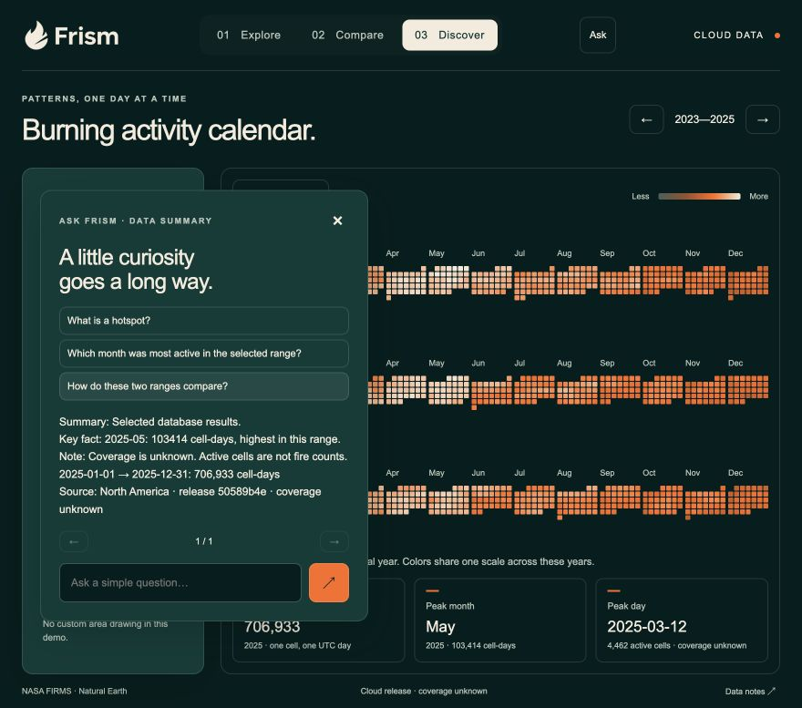

# Frism

**Explore satellite fire activity across places and time.** Frism is an interactive map and learning tool for students and researchers. It shows active grid cells, compares date ranges, and turns daily counts into a calendar.

**Live website:** [apex4space.vercel.app](https://apex4space.vercel.app)

**Presentation:** [Slides (PDF)](present/NASA-final-presentation.pdf) · [Demo video: Introducing Frism](https://www.youtube.com/watch?v=mhyx-JkKgfM)

## See it in action

| Explore hotspots | Compare date ranges |
| --- | --- |
|  |  |

| Discover daily patterns | Ask about the data |
| --- | --- |
|  |  |

These screenshots were taken from the live site on 15 November 2026.

## What you can do

- Search for a country, continent, or the world; choose one day or a date range; zoom in to see active cells.
- Compare two date ranges, including ranges that overlap, with linked maps and a shared color scale.
- Browse a three-year daily activity calendar and open any day on the map.
- Ask simple questions about the selected data. The cloud site gives short database summaries. A local installation can also use Ollama with `gemma4:e2b`.
- Open and close panels to give the map more space. The main views fit without page scrolling.

## The problem and our solution

NASA FIRMS provides active-fire detections from MODIS and VIIRS. Their records span different years and the sensors have different detection abilities. Adding raw detections across sensors can give a misleading time comparison. Frism puts the available detections on one spatial grid and one UTC calendar, then lets people inspect **where and when grid cells were active**. The map, year comparison, calendar, and chat all use the same checked counts.

This is a common *analysis unit*, not a calibration of MODIS against VIIRS. Use Frism to find patterns and form research questions; do not read its counts as a measured change in wildfire frequency. The [presentation](present/README.md) explains the project idea. The current MVP's exact metric is described below.

## Data source and release

The current release covers **2000-11-01 through 2026-11-11**. Its [313 monthly Parquet files](time-series-api/data/areas/world/parquet-v1/monthly/) total **802,362,812 bytes** and hold **150,615,549 country/cell/day rows**. They are checked into this repository for local use. The live API reads the same checked release from Vercel Blob. There are 230 source country codes, seven geographic groups, and World in the area picker.

The upstream source is [NASA FIRMS active-fire data](https://firms.modaps.eosdis.nasa.gov/), available as CSV from the [FIRMS archive](https://firms.modaps.eosdis.nasa.gov/download/). The original raw CSVs (about 6.5 GB on the source computer) are **not** in this repository. The [supplied producer script](documents/sources/supplied-parquet-producer.txt) is preserved byte for byte; its SHA-256 is recorded in the [release manifest](time-series-api/data/areas/world/parquet-v1/manifest.json). The exact original CSV inventory and country-boundary file were not supplied with that script, so the raw-to-Parquet run cannot be fully reproduced from this repository alone. The checked Parquet release can be queried and validated directly.

### How the Parquet data was made

1. **Read CSVs in chunks.** The supplied script keeps latitude, longitude, and acquisition date, with a configured date range of 2000-11-01 to 2026-11-11. It drops invalid dates or coordinates and points outside longitude ±180° or latitude ±85.0511287798066°. Sensor, confidence, FRP, and observation-opportunity fields are not retained.
2. **Assign a country.** Points and country polygons are put in EPSG:4326. A strict `within` spatial join assigns the country code. Points on a boundary or outside all matched polygons are omitted.
3. **Assign a 10 km projected cell.** Longitude and latitude are converted to EPSG:3857 metres. Both grid indices use `floor(coordinate / 10000)`, including negative coordinates. The saved ID is `E3857_10K_R{row}_C{column}`. A projected cell is 10,000 metres wide; its ground area varies with latitude.
4. **Remove repeats.** Duplicate `(UTC date, country code, cell ID)` rows are removed within chunks and again across all chunks. DuckDB writes the result as Zstandard-compressed Parquet, partitioned by year and month. The output contains the date, country code, cell ID, year, and month; it contains no raw detection row or satellite label.
5. **Validate the release.** [`prepare_parquet.py`](time-series-api/scripts/prepare_parquet.py) checks every monthly file's schema, nulls, duplicate keys, date partition, grid ID, coordinate bounds, size, and SHA-256. The manifest binds the file hashes and grid rule to one release ID. The 313 months form a continuous sequence. See the [validation record](documents/logs/2026-11-15/detail/detail-parquet-release.md).

### How Frism answers a request

```text
Area + included UTC dates
  → saved country membership
  → only matching monthly Parquet files
  → distinct (date, cell ID) across countries
  → counts, optional cell pages, calendar, and chat context
```

FastAPI validates the request. DuckDB scans the relevant months. A border cell present under two countries counts once in a continent or World total for the same day. `unique_active_cells` is the number of distinct cells in the whole range; `total_cell_days` is the number of distinct `(date, cell)` pairs. Daily and monthly values come from those same pairs. Comparison ranges are calculated independently, even when they overlap. A map viewport limits only the returned cell shapes; the reported area totals still cover the full selected area.

The frontend uses plain HTML, CSS, and JavaScript with OpenLayers 10 WebGL rendering. Cell corners are transformed from EPSG:3857 into the EPSG:6933 map view for display; no new grid is made. Maps fetch cells in pages as users zoom. The cloud API downloads one month at a time from Vercel Blob, verifies its SHA-256, then removes its temporary copy. The local API reads the repository's Parquet files. The same routes support both.

**Limits:** A hotspot cell is not a wildfire event, a fire perimeter, or burned area. The data has no observation-coverage measure, so an empty day does not prove there was no fire. MODIS and VIIRS sensitivity is not normalized here. Comparisons across the sensor transition need further scientific checks. The presentation's broader harmonization goal should not be mistaken for completed sensor calibration in this MVP.

| Folder | Purpose |
| --- | --- |
| [`web-app/`](web-app/) | Frontend and local server launcher |
| [`time-series-api/`](time-series-api/) | API, data readers, importers, and tests |
| [`scripts/`](scripts/) | Prepare, upload, and check a Vercel release |
| [`documents/`](documents/) | Specs, plans, and validation records |
| [`present/`](present/) | Presentation PDF and video link |

## Run locally

Use Python **3.13 or newer**. From a fresh clone:

```sh
git clone https://github.com/TheMetaSetter/apex4space.git
cd apex4space
python3.13 -m venv .venv
.venv/bin/python -m pip install -e './time-series-api[test]' pyshp==2.3.1
```

The clone includes the checked Parquet files. The [manifest](time-series-api/data/areas/world/parquet-v1/manifest.json) uses a path relative to its own folder, so local queries need no data-path edit. The API checks file size and checks SHA-256 once when Git gives a file a new modification time; it checks again if that file changes. The clone is large because it includes about 802 MB of data.

Start the server and open [localhost:8000](http://127.0.0.1:8000):

```sh
.venv/bin/python web-app/serve.py
```

For local generated answers, run `ollama serve` and pull `gemma4:e2b`. The map works without Ollama. The hosted site currently uses database summaries because hosted AI is disabled.

To validate a different copy of this Parquet format, run the [validator](time-series-api/scripts/prepare_parquet.py) with a new output folder and the supplied producer script. It reads source files without changing them. Point `storage.global_release_path` in [`settings.json`](time-series-api/config/settings.json) to the newly checked manifest before starting the server. The [web app guide](web-app/README.md#current-parquet-release--15-november-2026) shows the full command.

## API and checks

The main route is `POST /v2/hotspots/ranges/query`. Dates are UTC and both `start_date` and `end_date` are included. It returns daily and monthly counts, period totals, and optional pages of cell geometry. `POST /v2/hotspots/years/query` serves yearly views; `POST /v2/chat/query` serves contextual answers. The running API also exposes `/docs` and `/openapi.json`.

```sh
cd time-series-api
../.venv/bin/python -m pytest -q
```

For API examples, see the [web app guide](web-app/README.md) and [OpenAPI contract](time-series-api/openapi.json). For deployment, limits, and rollback, see the [Vercel guide](web-app/VERCEL.md). Very long cloud date ranges may need to be split into shorter requests.

## Data credits

Hotspot source: [NASA FIRMS](https://firms.modaps.eosdis.nasa.gov/). Geographic outlines: [Natural Earth](https://www.naturalearthdata.com/). OpenLayers and Proj4js licenses are included in [`web-app/vendor/`](web-app/vendor/).
