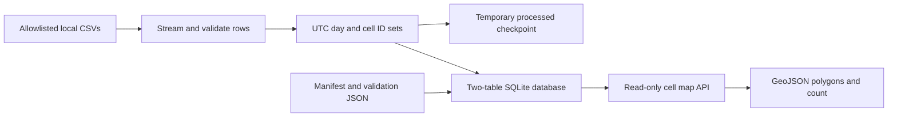

# Responder Hotspot MVP — Local Pilot Report

_Processing date: 14 November 2026 · Release: <code>responder-local-pilot-2026-09-01-v1</code>_

---

## 📋 Outcome

The local pilot produced a separate, integrity-checked SQLite database with exactly two user tables: <code>hotspot_cell</code> and <code>daily_hotspot_summary</code>. It used only the two allowlisted MODIS and VIIRS Suomi-NPP near-real-time CSVs for 2026-09-01 UTC in the South America pilot rectangle.

No Google Drive API or FIRMS network call was made. The source CSVs remained in the user-provided local directory; source rows were processed transiently. The API is ready for offline cell-map queries. Browser rendering and web developer feedback remain pending.

The result is a spatially deduplicated hotspot-cell count, not a count of distinct fires. It does not establish observation coverage.

## ⚙️ Reproducibility and provenance

The run used <code>config/processed-settings.json</code> and local directory input mode. The configuration selects only the MODIS Terra/Aqua NRT 2026 file and the VIIRS Suomi-NPP NRT 2026 file. It sets:

- Grid: <code>pilot-10km-v1</code>, 10 km equal-area cells in EPSG:8857, origin (0, 0) metres, floor/half-open cell edges.
- Area: <code>south-america-pilot-rectangle</code>, catalog version 1.
- Time: <code>[2026-09-01, 2026-09-02)</code>, interpreted as UTC days.
- Platforms: Aqua and Suomi-NPP.
- Limits: 80 MiB per file, 256 MiB per run, 100,000 cell/day memberships.

The executable command used an environment variable for the private local input root:

```bash
python scripts/prepare_data.py \
  --settings config/processed-settings.json \
  --release-id responder-local-pilot-2026-09-01-v1 \
  --input-dir "$FIRMS_INPUT_DIR"
```

The input file list is an exact settings allowlist. Other CSVs, archives, notebooks, sensors, and dates under the directory were not read. Both selected files were fully streamed. The reducer checked rectangular CSV rows, source headers, coordinates, timestamps, satellite/platform identity, version consistency, full byte count, SHA-256, and unchanged file identity. The VIIRS instrument label needed a source-specific SNPP validation alias; an existing parser case failed before the fix and passed afterward.

The published release metadata contains compact file identities, hashes, source versions, settings, and validation checks. It stores no row IDs, raw rows, FRP, brightness values, or copied CSV.

## 📊 Processing measurements

| Measure | Result |
| --- | ---: |
| Source bytes scanned | 79,036,082 |
| Rows seen across both selected files | 929,011 |
| Rows used after day/platform/area selection | 3 |
| Unique cell/day memberships after union | 2 |
| Unique active cell shapes | 2 |
| Daily summaries published | 1 |
| Database plus release metadata saved | 14,623 bytes |
| Peak Python traced memory | 1,434,050 bytes |
| Peak resident memory | 75,759,616 bytes |
| Elapsed time | 32.915 seconds |
| Processed release hash | 09adc498e6e237e0e55737ea1c5467b0992e85187b369ddc7f58af1f512a860c |

The three selected source detections resolve to two distinct 10 km cells after union across the two platforms. The result is one area/day summary with two sorted cell IDs.

## 📚 Data dictionary and observational structure

| Field | Meaning, units, and allowed values | Use in this preprocessing |
| --- | --- | --- |
| <code>latitude</code> and <code>longitude</code> | Degrees, bounded by −90..90 and −180..180. NASA describes these as nominal fire-pixel centers; they are not field-confirmed fire locations. [^1][^2] | Validated and projected into EPSG:8857. Source coordinates are discarded after reduction. |
| <code>acq_date</code>, <code>acq_time</code> | Acquisition date and UTC HHMM time. [^1][^2] | Parsed to UTC; the resulting date selects the half-open day window. |
| <code>satellite</code> | Product-specific satellite code. MODIS A is Aqua and T is Terra; VIIRS N is Suomi-NPP. [^1][^2] | Checked against product identity and selected platforms; Terra rows are filtered out. |
| <code>instrument</code> | Source instrument/platform label; no physical unit. | Checked against product/platform identity, including the selected VIIRS SNPP label; not persisted. |
| <code>version</code> | Text collection and processing mode; FIRMS distinguishes NRT, URT, RT, and standard processing. [^1][^2] | Each row is checked for a consistent collection base; compact observed labels are retained in release metadata. |
| Brightness fields | MODIS channel 21/22 or 31 and VIIRS I4 or I5 temperatures in kelvin. The channels are product-specific. [^1][^2] | Header/channel names are checked. Values are not used or saved. |
| <code>scan</code> and <code>track</code> | Source pixel dimensions in kilometres. [^1][^2] | Not used by the grid assignment and not saved. |
| <code>confidence</code> | MODIS confidence 0–100; VIIRS low, nominal, or high categories. [^1][^2] | Not used to filter or weight detections; not saved. |
| <code>frp</code> | Fire radiative power in megawatts (MW). [^1][^2] | Not used or saved. This release has no FRP result. |
| <code>daynight</code> and optional <code>type</code> | Day/night or source type categories. [^1][^2] | Not used or saved. |

The observational unit is one transient FIRMS detection row. There are no subjects, specimens, treatment groups, or experimental replicates. Repeated detections and multiple sensor passes are pooled only at the declared UTC-day and grid-cell level; the cell ID set prevents one cell from being counted twice on the same day. This is descriptive preprocessing, with no model fit or train/validation/test split.

## 🗃️ Database and release structure

The database at <code>time-series-api/data/processed.sqlite3</code> contains exactly:

| Table | Key | Contents |
| --- | --- | --- |
| <code>hotspot_cell</code> | <code>(grid_version, cell_id)</code> | Center coordinates and full cell GeoJSON geometry, stored once per grid version. |
| <code>daily_hotspot_summary</code> | <code>(release_id, area_id, date)</code> | Nullable count, nullable sorted unique IDs, and explicit day status. |

The release directory contains <code>manifest.json</code> and <code>validation.json</code>. Source identities, checksums, version labels, processing settings, and data hashes are recorded as compact provenance. The separate sample release and legacy database remain outside this pilot.

Temporary processed checkpoints contained only per-day cell IDs and compact provenance. After validation they were removed. The processed database has no raw table, raw CSV, or raw-row file.



## 🌐 Offline API verification and web handoff

A fresh FastAPI TestClient loaded the processed database and release. App-level Drive and FIRMS access functions were replaced with failing guards. Two POST requests to <code>/v1/hotspots/cells/query</code> returned status 200; both call counters stayed at zero. The response body was identical on repetition.

The GeoJSON had two polygon features and an active-cell count of 2. Its sorted feature IDs matched the stored daily summary IDs exactly. The response status was <code>coverage_unknown</code> with one warning that observation coverage is unknown for the date.

**Prepared web developer request:** render the saved GeoJSON with <code>dataProjection: 'EPSG:4326'</code> and the actual OpenLayers view projection; draw the cell vector layer above the basemap. Show the date, selector, count, <code>coverage_unknown</code> status, and warning together. Also render fixture examples for <code>observed_zero</code>, <code>partial</code>, and <code>missing</code> so zero, partial, and null states are visibly distinct. Verify polygon placement, count, status, and layer order in one review.

No web developer recipient was found in the connected contacts or recent project email, and no approved project message channel is configured here. The handoff is prepared but not sent; visual verification and developer feedback are pending. No approval is inferred.

## 🧪 Verification record

| Check | Result |
| --- | --- |
| Processed release checker | Passed; 2 cells, 1 summary, valid processed-data hash. |
| Final collection | 30 test cases. |
| Final suite | 30 passed; one Starlette/httpx deprecation warning. |
| Offline query | Two identical successful response bodies; Drive/FIRMS call counters stayed at zero. |
| Summary/GeoJSON consistency | Both stored summary IDs matched the two feature IDs. |
| Coverage interpretation | Returned <code>coverage_unknown</code> and its warning. |
| HTML/SVG and documentation structure | Passed: HTML parsed with no missing local links, SVG parsed as XML, OpenAPI JSON parsed with the cell route present, and Markdown links/fences resolved. |
| Web developer map rendering | Pending external visual review. |

## ⚠️ Limits and interpretation

This is the checklist’s one-day pilot, not a run over every downloaded archive or CSV. It covers one date, one rectangle, Aqua and Suomi-NPP, and two NRT product files. The source files do not include usable-observation footprints, so this result cannot establish complete coverage, a clear day, or absence of fire.

The output does not identify independent fires or perimeters, validate MODIS–VIIRS equivalence, estimate harmonized counts, or provide daily FRP. More areas, dates, products, and coverage evidence require a separately planned run.

## 🔗 References

[^1]: NASA FIRMS. [MODIS Fire and Thermal Anomalies field descriptions](https://firms.modaps.eosdis.nasa.gov/content/descriptions/FIRMS_MODIS_Firehotspots.html).

[^2]: NASA FIRMS. [VIIRS Fire and Thermal Anomalies field descriptions](https://firms.modaps.eosdis.nasa.gov/content/descriptions/FIRMS_VIIRS_Firehotspots.html).

[^3]: Kassis, T., Agarwal, V., He, Y., Patel, D., & Brueckner, A. M. (2026). *Scientific Agent Skills: A Library of Procedural Knowledge for Research Agents*. https://doi.org/10.48550/arXiv.2609.00065.
