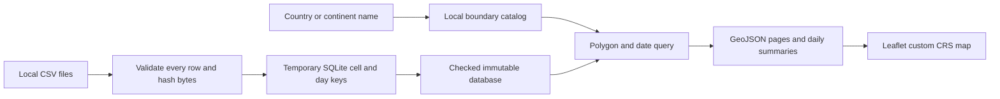

# Implementation plan: reusable FIRMS importer and named-area queries

## 📋 Intended result and planning status

Deliver a portable Python entry script that accepts arbitrary FIRMS CSV filenames or directories, scans every data row and acquisition date, and publishes a checked SQLite database. The backend resolves country/continent names to polygons and returns 10 km hotspot cells and daily counts for Leaflet.

Execution is authorized. The user approved the compact third processed table on 2026-11-14 and requested every step in this plan be executed in order, with each completed checklist item marked. The phase structure is therefore approved for execution. To preserve the user's requirement to include every valid hotspot row while EPSG:6933 is defined only from 86°S to 86°N, use EPSG:6931 for latitude >86°N and EPSG:6932 for latitude <86°S; EPSG:6933 owns both exact ±86° boundaries. Record all three grid versions in the new release. This policy preserves polar rows without claiming EPSG:6933 covers them. The earlier pilot and its EPSG:8857 database remain separate.

Follow stages in order during implementation. Leave every execution checkbox empty until evidence exists. The current pilot and its EPSG:8857 database remain a separate schema/grid version.

## 🔎 Current evidence and change boundary

See [research](../research/research-firms-all-dates.md) for current symbols, input inventory, inspection limits, and external sources. There are nine input CSVs totaling 7,012,980,383 bytes. Actual date bounds and geographic extent require a full stream; filenames are not evidence of those bounds.

The pilot holds sets and shapes in RAM, limits ingest to one area/day and two filenames, and caps final cells/memberships. Its publisher and checker also materialize the full data hash payload. All these paths require replacement or version-specific handling for a global release. A larger value in `processed-settings.json` alone will not solve this.

The reusable artifact should be **one portable file**, proposed `time-series-api/scripts/preprocess_firms.py`, using standard-library CSV/SQLite plus pinned pyproj and Shapely. It must run without importing this repository's `app` package. Backend modules consume its published schema; they do not run the importer inside requests. Do not add an ORM, job queue, geocoding service, or plugin system.

## ⚖️ Options and outstanding decisions

| Option | Benefit | Cost | Recommendation |
| --- | --- | --- | --- |
| A. Keep exactly two final tables and global daily JSON ID arrays | Preserves the earlier two-table restriction and familiar summary shape | SQLite must expand daily arrays for area queries; no indexed cell/day join | Compared but not selected after the user approved B. |
| B. Add `hotspot_cell_day`, retain cell shapes and global daily summary | Indexed cell/date joins; summaries and map pages share one membership source | Changes the final schema from two to three processed tables | Selected: the user approved the compact third table on 2026-11-14. |
| C. Store date partitions as external Parquet files | Efficient bulk analytics | Adds another storage format/runtime and prevents a self-contained database | Do not select for this request. |

Selected option B contains only processed information. Its third table contains release/date/grid/cell keys, with no raw detection rows.

EPSG:6933 applies between 86°S and 86°N. [^1] The selected all-row policy assigns detections in that inclusive band to EPSG:6933, north-polar detections above 86°N to EPSG:6931, and south-polar detections below 86°S to EPSG:6932. Grid version is part of every cell key, so equal integer indices in different CRSs cannot collide. The ±86° ownership rule prevents duplicate assignment. A 6933 Leaflet view cannot display the polar bands as a valid projection; the backend still returns their geographic GeoJSON and labels each grid version.

Country inclusion keeps the pilot's **cell-center rule**: include a cell when the selected area's polygon covers its center. This is a count of active cells; the original detection inside that cell can lie across a country boundary. A detection-within-country definition would require retaining more spatial detail and is a different future product.

## 🧾 Frozen contracts to establish in Phase 1

### Input and reduction

- Accept repeated `--input` arguments, each a regular CSV or a directory recursively searched for `.csv`, case-insensitively. Deduplicate repeated canonical input paths and sort discovered paths for repeatability. Include the sample CSV. Ignore non-CSV files; do not silently ignore an invalid CSV.
- Use CSV headers and row values, never filename or folder names, to read data. Normalize header whitespace and BOM; reject duplicate normalized headers.
- Require `latitude`, `longitude`, and `acq_date`. FIRMS source coordinates are WGS84 geographic degrees (EPSG:4326), as explicitly used in NASA's CSV tutorial; CSV files themselves do not embed a CRS. [^5] Parse finite WGS84 coordinates and canonical ISO dates. Validate `acq_time` when present; use UTC acquisition dates. Support standard MODIS/VIIRS exports and the observed generic VIIRS brightness columns. Brightness/FRP/confidence are unused, so their product-specific names do not gate cell counting.
- Preserve source identity labels when supplied as compact provenance; absent or ambiguous optional sensor labels remain unknown. Never guess a collection or download time from filenames or modification time. Allow mixed valid version labels in a file, since this union does not perform sensor correction.
- Include all sensors, dates, confidence levels, and hotspot types by default. No hidden area/platform/date filter. No filename-derived maximum year.
- Each valid input row contributes one `(grid_version, cell_id, UTC_date)` membership. A uniqueness constraint deduplicates overlapping files, samples, NRT/archive copies, repeated passes, and different sensors in the same cell/day. A standard-product priority filter must not discard distinct memberships: this product intentionally represents their union.
- A malformed required value aborts publication with file and record number and a concise reason. Do not write raw rows to reports. Unsupported schemas, empty aggregate input, source mutation, disk exhaustion, and failed integrity checks are fatal. Never publish a partial-success database.

### Grid and projection

Use 10,000 m square cells in EPSG:6933 with origin `(0,0)`, integer floor indices, and half-open edges. Use `always_xy=True`. Assign before constructing geometry; construct each unique active cell once. This is a custom 10 km lattice in that CRS, not a claim of matching an NSIDC native pixel grid. Equal-area projected squares are not necessarily 10 km geodesic distances along every edge.

Use grid versions `firms-ease-global-10km-v2` (EPSG:6933), `firms-ease-north-10km-v2` (EPSG:6931), and `firms-ease-south-10km-v2` (EPSG:6932), all distinct from `pilot-10km-v1`. EPSG:6933 owns −86° and +86° exactly; the north grid owns latitude >86° and the south grid <−86°. Snap projected coordinates within 1e-6 m of a lattice edge before floor so exact edges belong to the east/north half-open cell. Canonicalize longitude +180° to −180°. Densify inverse-projection edges at no more than 1,000 m projected intervals, split antimeridian geometry, and clip EPSG:6933 cells to its geographic validity domain. Verify corners and inverse transforms are finite. Do not silently use EPSG:6933 outside its declared area.

### Dates, scope, and coverage

Discover minimum/maximum dates while scanning. Preserve every observed date and represent every calendar day between them in the global daily summary. Days with no imported records may have count 0 but must carry `coverage_unknown` and `input_state=no_records`; they are not verified clear days. Dates outside the imported range return an unavailable-date error. Empty cells for a country do not establish that the supplied files cover that country.

The manifest records observed extent, selected input hashes, row counts, date range, grid definition, reduction policy, software/PROJ versions, schema version, and logical table hashes. An observed extent is not a surveyed coverage boundary. No complete-coverage, harmonized-sensor, FRP, or independent-fire-event claim is made.

### Selected proposed schema B — compact third table approved

| Table | Key | Contents |
| --- | --- | --- |
| `hotspot_cell` | `(grid_version, cell_id)` | Integer column/row, projected bounds, geographic center, saved GeoJSON geometry. |
| `hotspot_cell_day` — new | `(release_id, date, grid_version, cell_id)` | One active membership; foreign keys to its shape and global daily summary. Add a reverse `(grid_version, cell_id, release_id, date)` index for polygon-selected cells. |
| `daily_hotspot_summary` | `(release_id, date)` | Global `area_id=world`, count, coverage status, input state. Remove duplicated ID arrays in this schema version. |

Use ordinary coordinate indexes for candidate filtering, then exact polygon-center checks. Do not introduce an R-tree merely as a default: its virtual/shadow tables also change table-count expectations. Benchmark normal indexes first. A country/continent daily summary is computed from selected cells and memberships, not copied from a global total. Return the resolved area ID and catalog version with that result.


### Area catalog

Proposed `config/world-areas.geojson` and `config/area-aliases.json` are versioned local assets separate from the user dataset. Prepare Natural Earth Admin-0 Countries at 1:10m, version 5.1.1, and record its source URL, checksum, and boundary policy. [^2] Read the source license and attribute it. Proposed new `scripts/prepare_world_areas.py` converts the downloaded shapefile once offline using a pinned build-only pyshp dependency plus Shapely, writes these catalog assets, and validates aliases/continent unions. Select and verify that dependency version during implementation; do not add it to the portable importer. Runtime requests make no geocoder/provider requests.

The user narrowed runtime area names to the areas of interest in the project: Viet Nam and South America. Resolve `VN`, `VNM`, `Vietnam`, `Viet Nam`, and `Việt Nam` to `country:VNM`; resolve `South America` to `continent:south-america`. Keep the country unit separate from the continent union. Other names return not found in this focused build.

Create South America from all Natural Earth country units assigned to that continent; store its exact 15 member IDs. Preserve islands, holes, multipolygons, and the antimeridian. Validate every included unit and fail on invalid geometry; do not repair or omit an included feature.

## 🔄 Data flow



## 🛠️ Phase 1 — Contracts and reproducible baseline

### Stage 1.1 — Freeze decisions and baseline

- [x] Record current worktree and preserve prior pilot changes. Read the current spec §10.6, signatures, pilot detail/report, and this research. Do not use the older proposed/paused plans as current execution evidence. The active branch is `anhkhoi-dev` at `cbfaf13ab50f91c09164b15c51208d21a819dbed`; all pre-existing pilot changes were retained.
- [x] Resolve polar handling using EPSG:6933 for −86°..+86° inclusive, EPSG:6931 above +86°, and EPSG:6932 below −86°, so no valid row is omitted. Record the user-approved three-table choice. The user's execution request approves the phase structure; the detailed execution checklist is [detail-firms-all-dates.md](../detail/detail-firms-all-dates.md).
- [x] Update the canonical spec and signatures, including the terminology map below. The devspec now distinguishes the schema-1 pilot from the schema-2 all-date path, and the signature reference defines the standalone importer, area catalog, and v2 API contracts. Record the change from OpenLayers to Leaflet and the new grid/schema version.
- [x] Collect the existing tests and record their actual count. Baseline: 30 cases collected with `/private/tmp/apex-firms-venv-313/bin/python -m pytest tests --collect-only -q`; this is a collection count, not a passing test claim. The prior 30-case cap belongs to the pilot; retain 30 where useful, but do not remove necessary tests solely to retain that historical cap.

### Stage 1.2 — Freeze schema and area policy

- [x] Define schema version 2, constraints/indexes, logical-hash encoding, input error policy, coverage states, and every grid boundary rule in the [execution detail](../detail/detail-firms-all-dates.md) and devspec §10.7.
- [x] Freeze focused catalog provenance and geometry rules: Natural Earth Admin-0 1:10m v5.1.1, Viet Nam plus South America's exact Natural Earth members, normalized aliases, reject invalid included polygons, and keep catalog separate from importer/database. The source and catalog hashes are recorded in Phase 3.
- [x] Define request/response and paging contracts in the signatures and devspec before production behavior. Existing pilot routes remain schema-1 compatible; v2 rejects schema-1 datasets explicitly.

Complete when all decisions are explicit and small fixtures can express the expected outputs without interpretation.

## 🐍 Phase 2 — Portable importer and small complete database

### Stage 2.1 — Discover and validate arbitrary files

**Proposed new file:** `time-series-api/scripts/preprocess_firms.py`. Owns CLI parsing, discovery, CSV reading, grid assignment, staged writes, final checks, and publication. Keep it under 500 lines and each function under 50 by using a small direct pipeline, not a class framework.

- [x] Implement `discover_inputs(inputs)`, `read_rows(path)`, `assign_grid_cell(...)`, `build_database(...)`, and `main(...)` in the single portable entry script [preprocess_firms.py](../../../../time-series-api/scripts/preprocess_firms.py), kept under 500 lines with each function under 50 lines.
- [x] Reuse local byte hashing and identity checks without importing pilot filters, filename mappings, or in-memory results; `preprocess_firms.py` has no `app` imports.
- [x] Stream UTF-8/BOM CSVs with 64 KiB fields, 1 MiB records, strict widths, quoted newlines, and missing final newline; verify bytes at EOF and recheck file set/identity before publish. Covered by the multi-file fixture and source-mutation test.
- [x] Use fixed 4,000-row SQLite batches and `ON CONFLICT DO NOTHING`; deduplicate overlapping source rows without a global Python set or per-row shape creation.

### Stage 2.2 — Finalize and publish

- [x] Aggregate dates and distinct shapes from scratch SQL; write shapes and dense summaries before memberships; stream the three logical hashes; validate shape/day references, daily counts, and dates. Verified by the standalone checker and independent SQLite assertions.
- [x] Publish exactly `hotspot_cell`, `hotspot_cell_day`, and `daily_hotspot_summary`, with no raw rows or JSON ID arrays.
- [x] Create the three release artifacts in a sibling staging directory, run integrity/FK checks, fsync, and atomically rename; refuse an existing output. The CLI completed from `/private/tmp`.
- [x] Clean only invocation-owned work/stage directories on failure; the injected work-budget failure leaves no release or scratch directory. Renamed/reordered/overlapping input fixture runs have identical release and logical hashes.
- [x] Use a 512 MiB free-space reserve, bounded SQLite cache and batches, optional work/output byte budgets, and record peak RSS/scratch bytes. Limits abort the build; they never filter rows.

**Proposed CLI, not an existing executable command:**

```sh
python scripts/preprocess_firms.py --input /path/to/firms --output-dir /path/to/new-release
```

`--input` may repeat for separate files/directories. Default behavior is recursive CSV discovery, all dates/platforms, 10 km grid, and the approved polar policy. `--output-dir` is explicit and must be new. Derive a stable release ID from the sorted distinct input-content hashes, schema/grid definition, and reduction policy; source renaming must not change logical dataset identity. Record per-path provenance separately. Optional byte/memory budgets are safety limits, not data filters. No settings file, API key, Drive access, or date flags are required for the common command.

Complete: a renamed two-file fixture ran through the portable CLI from `/private/tmp`, passed the independent checker, and produced the same logical result on reordered/overlapping fixture input.

## 🌍 Phase 3 — Resolve named areas locally

**Proposed new file:** `time-series-api/app/areas.py`. Own `load_world_areas`, `resolve_area_name`, and candidate spatial selection. Existing `app/cells.py` retains pilot contracts; avoid forcing global names into its prepared-rectangle validation.

- [x] Load and validate the focused Viet Nam/South America assets at startup. Build a normalized alias lookup; unknown names return 404 and catalog failure makes the new routes unavailable. Verified by catalog-loader tests and app startup.
- [x] Resolve names to `country:VNM` or `continent:south-america` and exact polygons. Cache the immutable catalog in memory, not user CSVs. Both focused areas resolve to their checked Natural Earth polygons.
- [x] Use bbox candidates followed by exact polygon-center checks. Multipolygons are checked as exact union geometry; country borders are not replaced by a containing rectangle. Verified with local geometry fixtures.
- [x] Keep a display boundary distinct from the exact filtering boundary if simplification is introduced. No simplified outline is used; responses report the exact catalog version and inclusion rule.

Complete when aliases, islands, holes, border centers, and ambiguous/unknown names pass deterministic tests using small local fixtures.

### Ordered source and catalog checklist

- [x] Download the Natural Earth Admin-0 Countries 1:10m v5.1.1 archive and record source checksum, fields, de-facto policy, and public-domain terms in [detail](../detail/detail-firms-all-dates.md). Source validation found an invalid Egypt ring; see the unresolved strict-policy exception there.
- [x] Pin pyshp 2.3.1; validate source fields and CRS plus all selected country geometries. Every selected feature is valid; invalid Egypt is outside the focused scope.
- [x] Build and validate `country:VNM` and the 15 South America country IDs.
- [x] Union South America and save its exact member IDs.
- [x] Write normalized aliases for Viet Nam and South America.
- [x] Write and hash all catalog assets; the runtime loader checks hashes, IDs, aliases, memberships, and geometry.
- [x] Select bbox candidates and confirm exact polygon-center coverage; tested for both focused areas.

## 🌐 Phase 4 — Backend map pages and daily summaries

**Proposed new file:** `time-series-api/app/area_queries.py`. Own typed version-2 request/response models and SQLite query functions. Register its handlers through existing `app/main.py:create_app`, using existing request guards and read-only database connections. Add schema-2 dispatch to `scripts/check_results.py` and processed database configuration without changing the old pilot paths.

- [x] Add `POST /v2/hotspots/query` with named areas, ISO date, 1–10,000 page size, signed cursor, GeoJSON cells, canonical area/catalog identity, full count, coverage warning, and paging fields. The schema-2 route tests pass.
- [x] Add `POST /v2/hotspots/summaries/query` with an exclusive end date, 366-day limit, and empty days carrying unknown coverage. The full release accepts 365-day ranges for both areas.
- [x] Validate request bounds, schema, date availability, area catalog, and cursor; bind SQL values. Exact center-selected cell IDs use the saved cell/date index. SQL and candidate reads are streamed or batched; raw CSVs are not used.
- [x] Count all matching cells before paging. Signed cursors bind the release hash, area/catalog, date, grid versions, page size, and last key. Fixture page tests show a stable full count while cells change across pages.
- [x] Return full nominal cell polygons and stable IDs as longitude/latitude GeoJSON. Counts use center inclusion, independent of border clipping.
- [x] Apply and measure the 5-second query deadline. On the full database, one-year summaries took 1.24 seconds for Viet Nam and 1.78 seconds for South America after exact cell selection was computed once per request. An earlier scan timed out; the indexed query was improved and remeasured. Startup checks release schema and logical-hash metadata; full checks run offline.

Illustrative proposed request:

```json
{"release_id":"<64-hex-release-id>","area_name":"viet nam","date":"2023-07-12","page_size":1000}
```

Complete when focused country and continent counts match independent fixture results, pages enumerate exactly the counted IDs, and requests read only the local release database.

## 📦 Phase 5 — Full input run and independent verification

- [x] Ran complete multi-file fixtures, a real 74,605-row sample CSV, and then all nine CSVs with no area/date/platform filters. Short `acq_time` values such as `3` are accepted as zero-padded UTC `0003`.
- [x] Recorded all nine relative paths, exact byte sizes and hashes, per-file and total row counts, observed dates, membership counts, cell count, database/scratch sizes, peak RSS, and elapsed time in the release manifest and CLI output.
- [x] The schema-2 checker streamed every table and passed logical hashes, schema, references, daily counts, min/max dates, dense days, and no-raw-table checks.
- [x] Added an independent pyproj-based fixture reference for expected cell/day keys. Renamed, reordered, and duplicate input fixture runs have identical logical data.
- [x] Reconciled all 86,160,406 valid source rows to 86,160,406 grid assignments; 65,344,313 duplicate cell/day memberships are recorded separately. All nine files contributed rows.
- [x] Kept the earlier pilot and selected schema-1 release intact. The schema-2 release is on the separate `global_release_path`; temporary build files were cleaned after validation.

Measured full run: 86,160,406 rows; 2000-11-01 through 2026-11-11; 20,816,093 cell/day memberships; 164,845 cells; 6,375,231,488 database bytes; 1,309,143,040 peak scratch bytes; 1,248.76 seconds. Every assigned membership used EPSG:6933; no polar grid membership was present.

## 🗺️ Phase 6 — Leaflet handoff and documentation

The frontend requirement now names Leaflet, superseding the earlier OpenLayers handoff. CRS is configured on the map. For an actual EPSG:6933 view, specify a compatible Leaflet stable version plus Proj4Leaflet/Proj4js, projected bounds, origin, zoom resolutions, and clipping extent. A plain local world polygon/ocean background goes in the lowest pane; country outlines and hotspots occupy higher panes. Do not put ordinary Web Mercator tiles into that custom map. [^3][^4]

The backend sends standard GeoJSON longitude/latitude; Leaflet projects those coordinates for display. If polar grids are selected, the 6933 view cannot be presented as a valid full-pole display: preserve their records in the database/API and provide a polar-view contract for those areas. UI implementation remains separate; this phase prepares a concrete documented contract and sample payloads.

- [x] Update README, canonical devspec/signatures, schema guide/SVG, OpenAPI guide, and generated schema for the all-date release and focused Viet Nam/South America contract.
- [x] Provide Viet Nam and South America examples. Full-database paging kept the count at 1,083 while returning 1,000 then 83 cells; a zero-count Viet Nam result stayed `coverage_unknown`. Unknown names and unavailable dates return explicit errors.
- [x] Record Leaflet visual verification as pending; it has not been performed. No external developer was contacted.

## 🧪 Verification plan

Extend existing `tests/test_sources.py`, `test_storage.py`, `test_analysis.py`, `test_api.py`, and fixtures with meaningful behavior checks. Keep implementation functions at most 50 lines and code files at most 500 lines; organize fixtures around distinct behaviors without dropping assertions to meet a line/count target.

| Boundary | Required cases |
| --- | --- |
| CSV discovery/parsing | Arbitrary Unicode names, nested directories, `.CSV`, BOM, CRLF, quoted newline, malformed row, generic VIIRS headers, all nine observed schemas, empty input. |
| All dates and union | Noncontiguous years, leap day, unsorted files, archive/NRT overlaps, renamed copy, same-cell multiple sensors, two distinct cells, changed source during read. |
| Projection | Negative floor indices, exact edges, ±180° canonicalization, valid ±86° ownership, selected polar branch, invalid/nonfinite coordinates, valid seam polygons. |
| Persistence | Duplicate-key reduction, foreign-key integrity, daily equality, streamed hashes, interrupted build, disk cap, no overwritten output, no raw rows. |
| Geography | Viet Nam aliases/accents, South America members, holes/islands, center on border, unknown name, no available geographic coverage evidence. |
| API | Full count versus returned page, cursor binding and all-page equality, full year-window summaries, timeout, stable repeats, reader/network guards, schema-1 isolation. |

Existing verification commands, run from `time-series-api/` after implementation:

```sh
python -m pytest tests --collect-only -q
python -m pytest tests/test_sources.py tests/test_storage.py tests/test_analysis.py tests/test_api.py -q
python -m pytest tests -q
```

Use the project's Python 3.13 environment. These commands were not run during planning. New-script commands and schema-2 checker arguments must first be implemented and documented; none is presented as a working command today.

## 🔤 Terminology and migration map

| Prior object | New object | Status and ownership | Migration |
| --- | --- | --- | --- |
| `hotspot_cell` | `hotspot_cell` | Unchanged concept: reusable active cell shape; importer owns data | New grid/schema version; never reuse EPSG:8857 IDs as EPSG:6933 IDs. |
| Area/day `daily_hotspot_summary` | Stored global/day summary plus query-derived area/day summary | Scope split; importer owns global rows, backend owns area aggregation | Explicit schema-2 fields and response contract; no silent global total reuse. |
| JSON cell-ID membership | `hotspot_cell_day` | New normalized processed relation; importer owns | Rebuild from CSVs; pilot has only its selected area/day and cannot backfill all data. |
| Exact local source allowlist | Recursive CSV discovery | Replaced in new portable script | Preserve pilot entrypoint, add a new all-input entrypoint. |
| `AreaRecord` pilot rectangle | Named country/continent catalog | New geographic catalog with stable IDs; backend owns resolution | Keep old prepared-area contracts schema-1 only. |
| `pilot-10km-v1`, EPSG:8857 | New EPSG:6933 grid and optional polar grids | Changed spatial identity | Full rebuild; new cell IDs, manifests, hashes and cursor binding. |
| OpenLayers handoff | Leaflet handoff | Frontend integration changed by user | Update docs and samples; no claim of frontend implementation. |

## ✅ Acceptance and unresolved review

- [x] One portable script command processes every valid CSV row and date without relying on file names or remote FIRMS/Drive calls.
- [x] Final SQLite contains only the three processed tables, reconciles all input rows, and has a stable content-based release ID.
- [x] Viet Nam and South America resolve to explicit polygons; full daily counts match paged cells under the cell-center rule.
- [x] Named-area requests read the built database and do not re-ingest or access CSV files.
- [x] Resource limits and malformed inputs abort before publish; they do not silently remove data or replace a prior release.
- [x] Coverage uncertainty is returned even when a count is zero.
- [x] The approved three-table schema is recorded, the polar grid policy preserves all valid rows, and the user-authorized phase structure is documented before implementation.

[^1]: NSIDC, [A Guide to EASE Grids](https://nsidc.org/data/user-resources/help-center/guide-ease-grids); installed pyproj EPSG:6933 metadata identifies the 86°S–86°N area of use.
[^2]: Natural Earth, [Admin 0 – Countries](https://www.naturalearthdata.com/downloads/10m-cultural-vectors/10m-admin-0-countries/), including country-unit and boundary-policy descriptions.
[^3]: Leaflet, [stable reference](https://leafletjs.com/reference-1.9.4.html), map CRS and panes.
[^4]: Proj4Leaflet, [custom projection documentation](https://www.liedman.net/Proj4Leaflet/).

[^5]: NASA FIRMS, [Visualization in Python](https://firms.modaps.eosdis.nasa.gov/content/academy/data_visualization/firms_visualization.html), constructs points from CSV longitude/latitude with `crs="EPSG:4326"`.
